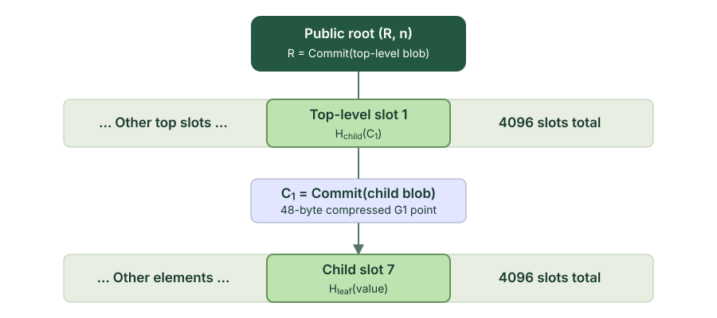
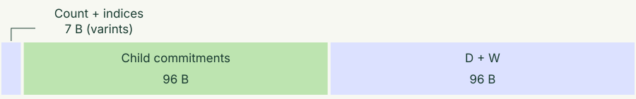

# Blob Tree: Two levels of blobs, one membership proof

We already have [SMT](https://github.com/nervosnetwork/sparse-merkle-tree), but SMT proofs are quite large, especially when proving multiple elements at once. So we propose a new solution: the blob tree. At its core, it is a two-level path tree built on [c-kzg-4844](https://github.com/ethereum/c-kzg-4844), with [Shplonk](https://eprint.iacr.org/2020/081.pdf). Commit to as many as 16,777,216（4096*4096) elements in a tree with just two levels. Whether you query one element or many, the proof reduces to one KZG verification call. 

## 1. Tree structure

Every position has a two-level path.

Split an element's zero-based index $i$ into $\mathrm{row} = \lfloor \frac{i}{4096} \rfloor$ and $\mathrm{column} = i \bmod 4096$. Each bottom-level blob stores element hashes. The top-level blob stores hashes of child commitments. Both hashes are reduced modulo the BLS12-381 scalar field modulus $r$.

**Worked example:** index $4103 = 1 \times 4096 + 7$ belongs to child 1, slot 7. Its element hash is committed by $C_{1}$, and the hash of $C_{1}$ occupies top-level slot 1.



The root is constructed from the bottom up. Lines show dependencies; the diagram does not draw all 4096 slots to scale.

## 2. Proof reduction

Share child commitments, then combine the openings.

A proof includes a varint query count and a varint index per queried element, then one commitment for each queried child, followed by two points: the aggregate quotient commitment $D$ and the opening witness $W$. Each point occupies 48 bytes. Counts and indices use canonical unsigned base-128 varints, taking one to four bytes over the supported range. The maximum query count is $2^{24}$, and indices range from $0$ to $2^{24}-1$.

For queries `[0, 7, 4096, 4097]`, child 0 supplies columns 0 and 7, while child 1 supplies columns 0 and 1. The four queries share two child commitments.

| Queried elements $k$ | Queried children $m$ | Proof bytes | Pairing terms |
| ---: | ---: | ---: | ---: |
| 4 | 2 | 199 | 2 |



## Proof sizes

| Queries | Children m | Proof bytes |
| --- | --- | --- |
| One element: [7] | 1 | 146 |
| Four elements in one child: [0, 7, 77, 4095] | 1 | 150 |
| Two children: [0, 7, 4096, 4097] | 2 | 199 |
| Four children: [0, 4096, 8192, 16777215] | 4 | 298 |
| At least one element in every child | 4096 | At most 196708 + 4k |

$\text{Proof size} = v(k) + \sum_{j=0}^{k-1} v(i_j) + 48 m + 96$ bytes, where $v(x)$ is the number of bytes in the unsigned varint encoding of $x$ (including one byte for zero). This includes query indices and their count but excludes the public root and original elements. Since each varint takes at most four bytes, $4 + 4k + 48m + 96$ remains an upper bound. Each example assumes the vector is long enough to contain every queried index. Verification always uses two pairing terms.

Consider the scenario where many elements must be proven. The `48m` term accounts for the child commitments and can be estimated from the number of queried children. The worst case occurs when every child is in use. Since the number of children is about n/4096, where n is the total element count, the `48m` term is about n/85. For n = 100,000 and n = 1,000,000, this gives roughly 1.18K and 11.8K respectively. With every child queried, the proof is at most 196708 + 4k bytes; whether it fits in a CKB transaction also depends on the query count and the separately supplied elements.

Compared with the [SMT](https://github.com/nervosnetwork/sparse-merkle-tree) below, the reduction is significant:
```
cargo run --manifest-path blob-tree/Cargo.toml --locked --example proof_size --release
N (leaves)  M (queries) proof size(bytes)
    100000            1            146
    100000           10            604
    100000          100           1579
    100000         1000           4132

cargo run --manifest-path blob-tree/Cargo.toml --locked --example smt_proof_size --release
N (leaves)  M (queries) proof size(bytes)
    100000            1            599
    100000           10           4704
    100000          100          36850
    100000         1000         271763    
```


This proof size problem is why we seek a new tree structure rather than relying on the existing SMT.

The count and index savings depend on their values; see the encoding details below.

### The complete reduction, step by step

The reduction first commits to an aggregate quotient polynomial and then checks its relation to the claimed openings at a transcript-derived point. All five steps are shown below. Here, statement 0 is the top level, and statements 1 through m are the queried children in ascending child-index order.

> **Where Shplonk is used:** steps 2–4 perform the Shplonk-style reduction: aggregate the quotient polynomials, commit to the aggregate before deriving the checking point, then reduce all claimed openings to the single claim `g(z) = y`. Step 1 binds the public statement to the transcript; step 5 completes the proof with a standard single-point KZG opening and verification. This implementation defines its own transcript and wire format; it does not claim interoperability with other Shplonk implementations.

#### Step 1: Bind everything the proof claims.

$$
\begin{aligned}
T &= \mathrm{Encode}\bigl(\text{protocol domain, root, queries}, \\
    &\quad \text{values, child commitments}\bigr)
\end{aligned}
$$

The root contains both the commitment and vector length. The top-level opening claims child-commitment hashes; each child opening claims element hashes. Queries and child commitments use their canonical order. `Encode` includes the counts and lengths specified in the design document.

#### Step 2: Combine the quotient polynomials.

$$
\begin{aligned}
\rho & = \mathrm{hash\_field} ( \text{"rho"} , [ T ] ) \\
q_{i} ( X ) & = \frac{f_{i} ( X ) - I_{i} ( X )}{Z_{i} ( X )} \\
Q ( X ) & = \sum_{i = 0}^{m} \rho^{i} q_{i} ( X )
\end{aligned}
$$

$I_{i}$ interpolates the claimed point-value pairs, and $Z_{i}$ vanishes at their evaluation points. The division has no remainder when the opening claims are correct. The nonzero coefficient $\rho$ is derived from the complete transcript.

#### Step 3: Fix D before deriving the checking point.

$$
\begin{aligned}
D & = \mathrm{Commit} ( Q ) \\
z & = \mathrm{hash\_field} ( \text{"z"} , [ T , D ] )
\end{aligned}
$$

$D$ is the first of the two additional proof points. Deriving $z$ from both $T$ and $D$ binds the checking point to the quotient commitment. Each `hash_field` call uses domain-separated, length-prefixed SHA-256 followed by reduction modulo $r$.

#### Step 4: Reconstruct the combined commitment.

$$
\begin{aligned}
a_{i} & = \frac{\rho^{i}}{Z_{i} ( z )} \\
g ( X ) & = \sum_{i = 0}^{m} a_{i} f_{i} ( X ) - Q ( X ) \\
C_{g} & = \sum_{i = 0}^{m} a_{i} C_{i} - D \\
y & = \sum_{i = 0}^{m} a_{i} I_{i} ( z )
\end{aligned}
$$

The remaining claim is $g ( z ) = y$. The verifier derives every weight, the commitment $C_{g}$, and $y$ from the public statement and $D$. No additional evaluations need to be transmitted.

#### Step 5: Check one equation with two pairing terms.

$$
\begin{aligned}
W & = \text{KZG opening witness for} \; g ( z ) = y \\
e ( C_{g} - y \cdot G_{1} , G_{2} ) & = e ( W , [ \tau ] G_{2} - z \cdot G_{2} )
\end{aligned}
$$

$W$ is the second additional 48-byte point. The verifier calls c-kzg's `verify_kzg_proof` once. The pairing equation uses two Miller loops and one final exponentiation. Beyond the count, indices, and child commitments, the proof always contains exactly 96 bytes.

The order is $T \to \rho \to D \to z \to W$. This static tutorial explains the structure and proof size.

## 3. Proof size optimization

The implementation now encodes the query count and each absolute index as an unsigned base-128 [varint](https://protobuf.dev/programming-guides/encoding/#base-128-varints), without protobuf field tags. Each byte carries seven data bits, least-significant group first; the high bit indicates another byte follows. Values below 128 take one byte, below 16,384 take two, below 2,097,152 take three, and the remaining supported values take four.

## 4. Support non-membership
We require all elements in the tree to be ordered and unique. In a sorted tree, prove that a value $e$ is absent by authenticating its two adjacent neighbors:

$$
e_{\mathrm{before}} < e < e_{\mathrm{after}},
\qquad i_{\mathrm{after}} = i_{\mathrm{before}} + 1.
$$

Verify both neighbors with one batched membership proof against the same trusted root $(R, n)$.

At the boundaries, authenticate only the first or last element:

- If $e < e_0$, prove membership of $e_0$ at index $0$.
- If $e_{n-1} < e$, prove membership of $e_{n-1}$ at index $n-1$, using the trusted length $n$.

## 5. Highlights

- **Flexible values.** Elements are arbitrary byte strings, including empty strings, with no fixed field-size limit. Values must be unique;
- **Two levels, large capacity.** The structure supports up to 16,777,216 elements.
- **One KZG verification for many queries.** Both levels and all queried elements reduce to one KZG check with two pairing terms. 
- **Shared proof overhead.** Queries in the same child share one 48-byte commitment. When queries are locally distributed, the proof size doesn't change.
- **Non-membership from neighbors.** For a root built from sorted, unique values, applications can check absence using adjacent-neighbor membership proofs
- **CKB-VM verification.** The `verification-only` feature supports `no_std` verification

## 6. Differences from SMT

- **Root format.** An SMT root is a hash. A blob-tree root contains a 48-byte KZG commitment and the element count `n`; verification requires both.
- **Element format.** Blob-tree elements are arbitrary byte strings, including empty strings, rather than fixed-size hashes. The tree hashes them internally.
- **Element order.** Values must be unique and are stored in lexicographic byte order. Construction and verification sort supplied values internally, so callers can pass them in any order. Query indices refer to positions in the sorted tree and must be strictly increasing.

## Continues

Continue with the [design and terminology](../DESIGN.md)
